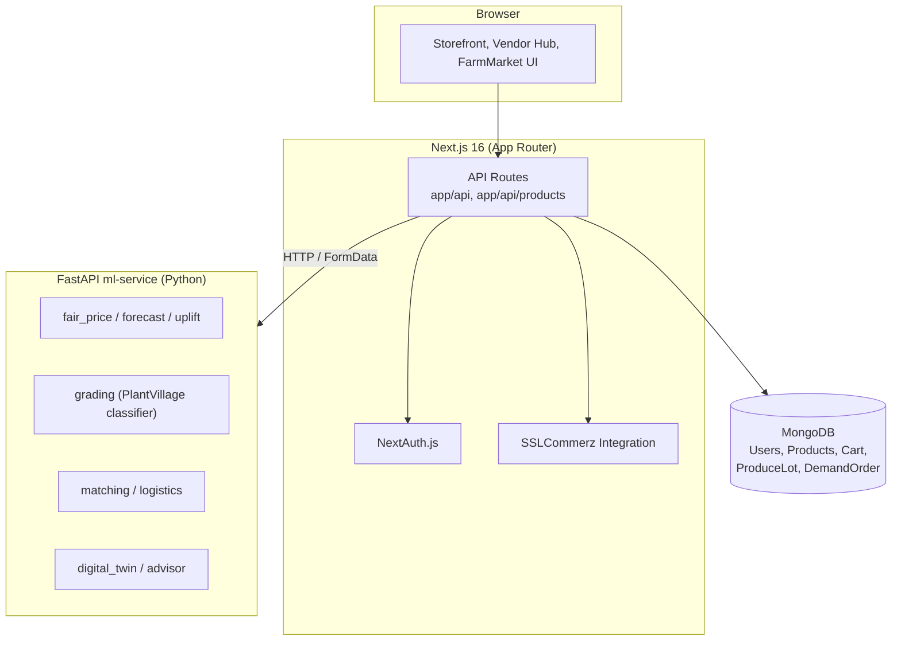

# KriShop

### Multi-Vendor E-Commerce Platform with FarmMarket: AI Price, Brand Identity & Quality Advisor for Farmers


KriShop is a full-stack agritech marketplace built with **Next.js 16** (App Router) and **MongoDB**. It combines an Amazon-style multi-vendor seller suite with advanced price intelligence:

1. **KriShop Marketplace**: A multi-vendor e-commerce application featuring role-based dashboards, local unit pricing (`kg`, `maund`, `sack`), device media uploads, and interactive vendor store branding profiles.
2. **FarmMarket**: An integrated upgrade helping smallholder farmers across Bangladesh decide *what price to ask* and *whether to sell today or wait*. Produce photo uploads yield quality grading, fair-price recommendations, uncertainty bands, and single-sentence Bengali advice. One-click buyer matching, dispatch, and digital twin batch tracing are fully integrated.

All FarmMarket numbers come from real datasets in `ml-service/data/`.

---

## Table of Contents

- [Quick Start](#quick-start)
- [FarmMarket Results at a Glance](#farmmarket-results-at-a-glance)
- [Theory of Change](#theory-of-change)
- [Marketplace & Vendor Features](#marketplace--vendor-features)
- [System Architecture](#system-architecture)
- [Technology Stack](#technology-stack)
- [Project Structure](#project-structure)
- [Environment Configuration](#environment-configuration)
- [Available Scripts](#available-scripts)
- [FarmMarket Technical Notes](#farmmarket-technical-notes)
- [Field Photos](#field-photos)
- [Verification & Routing Notes](#verification--routing-notes)
- [Security and Deployment Notes](#security-and-deployment-notes)
- [Roadmap](#roadmap)
- [Contributing](#contributing)
- [License](#license)

---

## Quick Start

### Option A: Docker (recommended)

The first build downloads images and packages, so allow several minutes.

```bash
docker compose up --build         # or: make demo
```

Open <http://localhost:3000/farmmarket>.

| Role | Email | Password |
|---|---|---|
| Farmer / Vendor | `farmer@demo.test` | `demo1234` |
| Buyer | `buyer@demo.test` | `demo1234` |

This starts the Next.js app, the FastAPI ML service, and a MongoDB instance pre-loaded with sample lots, orders, and traceable batches.

### Option B: Local Setup

**Prerequisites:** Node.js 18+ (Next.js 16 compatible), Python 3, and a MongoDB instance (local or Atlas).

```bash
# 1. ML Service (Terminal 1)
pip install -r requirements.txt
cd ml-service
python -m pytest tests                    # Run unit tests
uvicorn farmmarket.api:app --port 8000

# 2. Web Application (Terminal 2, repository root)
cp .env.example .env.local                 # Configure local environment
npm install
npm run dev                                # http://localhost:3000
```

> **Note:** If you reuse a `node_modules` directory installed from another OS, delete it and rerun `npm install` to update platform-specific Tailwind binaries.

---

## FarmMarket Results at a Glance

All results are measured on real datasets. Details are in the app's Evidence tab and in `ml-service/models/*.json`.

| Component | Result |
|---|---|
| Photo classifier (38 PlantVillage classes) | **90.1%** held-out accuracy, macro-F1 0.90 (6,041 train / 1,511 test real images; random split of lab photos) |
| Price forecasts (10 series, 14-day error, rolling backtests) | Best model chosen per series; naive baseline selected for 5 of 10 series |
| Lagged weather features | Tested; helped on **1 of 10** series |
| Timing rule, 2-year point-in-time replay | **+0.53%** average realised price across 5 crops (ungated). Garlic +0.83% (95% CI 0.06 to 1.73); cucumber -0.59% |
| Timing rule as shipped (wait advice only where gain is reliable) | **+0.17%** average (Garlic only; other crops advise immediate sale) |
| Field photos | Accuracy on real unconstrained field photos is unmeasured and expected to be below 90.1% |

---

## Theory of Change

**Target Users:** Smallholder farmers and agricultural vendors in Sylhet, Rajshahi, Feni, or Chattogram selling produce to local traders without national price visibility.

**Current Problem:** Farmers accept trader offer prices on harvest day. Wholesale prices swing 71% to 167% between best and worst months, while wholesale captures only 85-90% of retail price value.

**With KriShop & FarmMarket:** Farmers and vendors gain access to:
- Real-time national wholesale price trends.
- Price floors calculated from historical prices and custom input costs.
- Seasonal harvest timing advice.
- Photo-graded quality multipliers.
- Regional freight costs to buyer hubs.
- Amazon-style branded seller storefronts with custom unit pricing (`kg`, `maund`, `sack`, `bundle`).
- A sell-today-or-wait decision engine built on model uncertainty bands.

---

## Marketplace & Vendor Features

### Amazon-Style Vendor Onboarding & Management
- **Branded Store Creation (`/dashboard/products/new` & `/products/new`):** Multi-step listing form featuring store name branding, local unit types (`kg`, `maund`, `pcs`, `sack`, `bundle`), harvest origin/upazila, and quality notes.
- **Device Image & Logo Attachment:** Direct device uploads (`multipart/form-data`) supporting local previews for produce photos and store emblem logos.
- **Interactive Vendor Profile Editor:** In-dashboard modal allowing vendors to edit store names, owner details, farm locations, contact numbers, and brand logos on the fly.
- **Store Metrics Hub (`/dashboard/products`):** Real-time inventory statistics displaying active listings, total stock volume, and aggregate store valuation in BDT (৳).

### Access Control & Routing
- Route guards and ObjectId validation on dynamic parameter routes (`[id]`) to prevent server errors on static paths (e.g. `/products/new`).
- Role-based experiences for Customers, Vendors, Farmers, Buyers, and Administrators via NextAuth.js.

### Checkout & Payments
- SSLCommerz payment gateway integration with callback handlers for success, failure, and cancellation.

---

## System Architecture



---

## Technology Stack

| Layer | Technology | Purpose |
|---|---|---|
| Framework | Next.js 16 (App Router) | Web application and API routes |
| Language | JavaScript (ES2023), Python 3 | Frontend/Backend logic, ML service |
| Database | MongoDB with Mongoose | Data models (Products, Users, Carts) |
| Authentication | NextAuth.js | Role-based session management |
| Styling | Tailwind CSS | Responsive marketplace layout |
| Payment | SSLCommerz | Payment processing |
| ML Service | FastAPI, scikit-learn, Prophet, statsmodels | Forecasting, grading, logistics |
| Storage | Local Disk / Form-Data Stream | Product and store logo device uploads |

---

## Project Structure

```text
krishop/
├── app/
│   ├── api/                # API routes (products, user profiles, auth, farmmarket)
│   ├── dashboard/          # Role dashboards (/products, /farmer, /buyer, /admin)
│   ├── farmmarket/         # FarmMarket price intelligence UI
│   ├── marketplace/        # Public marketplace view
│   ├── products/           # Product creation (/new) and detail routes
│   └── (auth)/             # Login and registration pages
├── Components/             # UI components (Header, ProfileForm, Cart, ProductCard)
├── Model/                  # Mongoose models (Product, User, ProduceLot, CartModel)
├── utils/                  # DB connection, withAuth middleware, logistics helpers
├── ml-service/             # FastAPI service, datasets, model files, scripts
├── public/uploads/         # Uploaded store logos and product images
├── docker-compose.yml
└── package.json
```

---

## Environment Configuration

Create `.env.local` in the project root:

```env
MONGO_DB_URI=your_mongodb_connection_string
NEXTAUTH_SECRET=your_long_random_secret
NEXTAUTH_URL=http://localhost:3000

# SSLCommerz Credentials
STORE_ID=your_store_id
STORE_Pass=your_store_password

# Optional: Enables Gemini-written advice in the advisor
GEMINI_API_KEY=your_gemini_api_key
```

Never commit `.env.local` or environment secrets to version control.

---

## Available Scripts

| Command | Purpose |
|---|---|
| `npm run dev` | Start development server with Turbopack |
| `npm run build` | Build production application |
| `npm start` | Start production server |
| `npm run lint` | Execute ESLint checks |
| `make demo` | Build and launch complete Docker container suite |
| `make test` | Execute ML service test suite |
| `make train` | Retrain forecast models (~4 min) |
| `make vision` | Retrain photo classifier (~6 min) |

---

## Verification & Routing Notes

- **Dynamic Route Guards:** Dynamic API routes (`app/api/products/[id]/route.js`) check `ObjectId.isValid(id)` and guard against static keywords like `'new'` to prevent 500 CastError server crashes.
- **Route Synchronization:** Navigation controls target `/dashboard/products` for vendor inventory management and `/dashboard/products/new` for listing creation.
- **Header De-duplication:** Page-level components render within standard layout wrappers without duplicating top-level Header bars.

---

## Security and Deployment Notes

- **Server Validation:** Enforce role and resource ownership checks inside server API routes and server actions. UI conditional rendering is for user experience, not authorization.
- **Upload Restrictions:** Validate file types (JPEG, PNG, WebP) and file sizes server-side for all device media uploads.
- **Production Secrets:** Configure production secrets in host environment variables rather than hardcoded configurations.
- **Demo Accounts:** Remove default demo credentials prior to production deployment.

---

## Roadmap

- [x] Amazon-style vendor listing and store branding forms
- [x] Device image and logo upload support with instant previews
- [x] Vendor dashboard profile editor modal and live metrics
- [x] Dynamic route guard fixes for Next.js App Router
- [ ] Automated image optimization pipeline for user uploads
- [ ] Real-time order status notifications for vendors and buyers
- [ ] Deal confirmation and payment escrow for FarmMarket matches
- [ ] Product search filtering, sorting, and regional availability tags

---

## License

Refer to the repository license file for usage rights and distribution terms.

---

**KriShop: Connecting customers, empowering vendors with Amazon-style store branding, and giving farmers honest price intelligence.**
