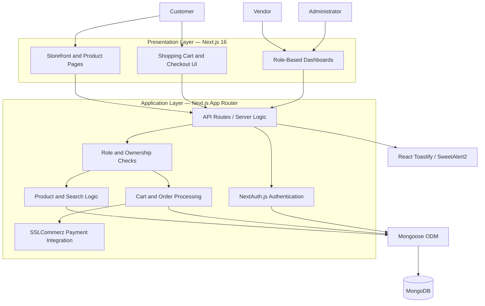
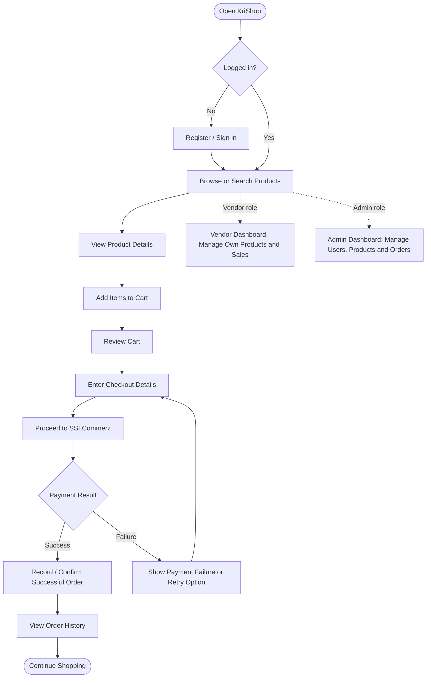
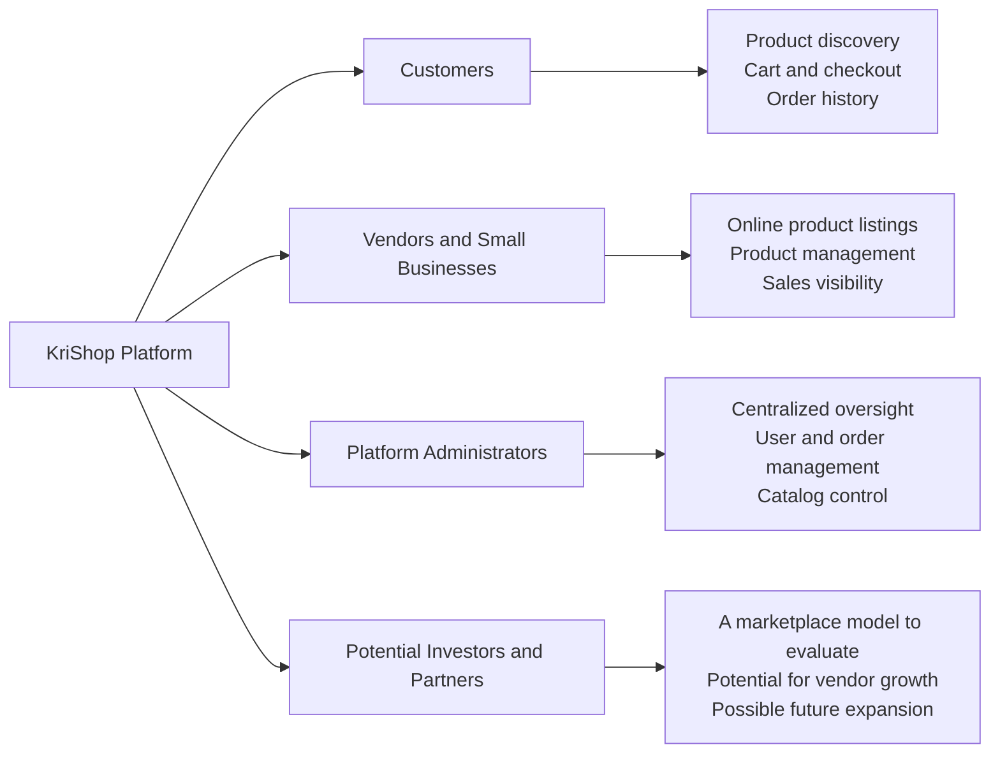

# 🛍️ KriShop

### A Modern Multi-Vendor E-Commerce Platform

> **Discover products. Empower vendors. Simplify online shopping.**

KriShop is a modern e-commerce application built with **Next.js 16** and **MongoDB**. It provides a shopping experience with role-based dashboards for customers, vendors, and administrators. The platform brings product discovery, cart management, order tracking, and online checkout into one responsive application.


---

## 📌 Table of Contents

- [Overview](#-overview)
- [Key Features](#-key-features)
- [User Roles](#-user-roles)
- [System Architecture](#-system-architecture)
- [System Workflow](#-system-workflow)
- [Who Benefits from KriShop?](#-who-benefits-from-krishop)
- [Technology Stack](#-technology-stack)
- [Project Structure](#-project-structure)
- [Getting Started](#-getting-started)
- [Environment Configuration](#-environment-configuration)
- [Available Scripts](#-available-scripts)
- [Security and Deployment Notes](#-security-and-deployment-notes)
- [Roadmap](#-roadmap)
- [Contributing](#-contributing)
- [License](#-license)

---

## 🌟 Overview

KriShop is designed to support a convenient online marketplace where customers can explore products, vendors can manage their own listings and sales, and administrators can oversee platform activity.

The application uses the **Next.js App Router** for the web experience, **MongoDB** for data storage, and **Mongoose** for database modeling. Authentication is handled with **NextAuth.js**, while the checkout flow integrates **SSLCommerz** for payment processing.

### Project Goals

- Make product discovery and purchasing accessible through a responsive interface.
- Give vendors tools to manage products and sales.
- Provide administrators with centralized platform-management capabilities.
- Support a clear checkout and payment-result flow.
- Establish a foundation that can be extended as marketplace needs evolve.

---

## ✨ Key Features

### 🔐 Authentication and Access Control
- User registration and login with NextAuth.js.
- Role-based experiences for customers, vendors, and administrators.
- Protected dashboard areas should be configured to enforce permissions on the server as well as in the UI.

### 🛒 Shopping Experience
- Browse and search products.
- View individual product details.
- Add items to and remove items from the shopping cart.
- Review order history.

### 🏪 Vendor Management
- Create, update, and delete vendor-owned products.
- Manage product listings and review sales information.
- Keep vendor operations organized through a dedicated dashboard.

### 🧭 Administration
- Manage users, products, and orders.
- Monitor key platform activity from an administrative dashboard.

### 💳 Checkout and Payment
- Checkout flow integrated with SSLCommerz.
- Payment success and failure handling.
- Payment credentials are configured through environment variables rather than committed to source control.

### 📱 Responsive Interface
- Mobile-first layouts using Tailwind CSS.
- Reusable UI components for a consistent shopping experience.

### 🔔 User Feedback
- React Toastify and SweetAlert2 for notifications and confirmation dialogs.

---

## 👥 User Roles

| Role | Main capabilities | Value |
|---|---|---|
| **Customer** | Browse and search products, manage cart, complete checkout, view order history | A convenient, centralized shopping experience |
| **Vendor** | Manage own products and sales through a dedicated dashboard | A digital channel to present products and manage sales |
| **Administrator** | Manage users, products, and orders | Centralized oversight and platform administration |

> **Access-control note:** Enforce role and ownership checks in server-side API routes/actions. Hiding a button or dashboard link in the frontend alone is not sufficient security.

---

## 🏗️ System Architecture

The following diagram shows the intended high-level architecture based on the technologies and features described for KriShop.



### Architecture Overview

1. **Presentation layer:** Responsive storefront, product pages, cart, checkout, and role-based dashboards.
2. **Application layer:** Next.js server-side logic and API routes handle application operations.
3. **Authentication and authorization:** NextAuth.js supports authentication; application logic must enforce each role's permissions.
4. **Data layer:** Mongoose provides structured interaction with MongoDB.
5. **Payment integration:** SSLCommerz supports the checkout payment flow and payment-result handling.
6. **Feedback layer:** Toast notifications and confirmation dialogs communicate actions and errors to users.

*This is a conceptual architecture diagram, not a claim that every component has been independently audited or that all integrations are production-hardened.*

---

## 🔄 System Workflow

This workflow illustrates a typical customer purchase alongside the role-based management flow.



### Typical Customer Journey

1. The customer visits KriShop and browses the product catalog.
2. They inspect product details and add items to the cart.
3. They review the cart and continue to checkout.
4. The payment flow redirects or connects to SSLCommerz as configured.
5. The application handles the payment result and presents the appropriate status.
6. The customer can review order history.

**Implementation consideration:** Order creation, payment verification, and order-status updates should be handled securely on the server. A browser redirect alone should not be treated as proof of payment; verify payment using the gateway's supported validation mechanism.

---

## 💼 Who Benefits from KriShop?

KriShop is intended to create value for several groups.



### 🛍️ For Customers
- Browse and search products from a digital storefront.
- Manage a shopping cart and access the checkout flow.
- Review order history in one place.
- Use a responsive interface across supported screen sizes.

### 🏪 For Vendors and Small Businesses
- Create and maintain their own product listings.
- Update product information as their catalog changes.
- Access a dedicated area for managing products and sales.
- Potentially reach customers through a shared marketplace, subject to the platform's actual launch and marketing strategy.

### 🧑‍💼 For Administrators
- Manage users, products, and orders from a centralized dashboard.
- Maintain oversight of platform operations.
- Support more consistent marketplace administration.

### 📈 For Investors and Strategic Partners
KriShop may offer a foundation for a multi-vendor commerce business. Potential areas of value to assess include:

- **Marketplace growth:** Whether customer demand and vendor participation can grow together.
- **Revenue opportunities:** Possible future commission, vendor subscription, featured listing, or service-fee models, if introduced and validated.
- **Operational scalability:** Opportunities to improve catalog management, order processing, vendor onboarding, and customer support as activity increases.
- **Expansion potential:** Possibilities for new product categories, delivery partnerships, analytics, and additional payment options.
- **Measurable traction:** Future assessment through active customers, active vendors, conversion rate, repeat purchase rate, order volume, average order value, and contribution margin.

> **Investor transparency:** These are potential benefits and business opportunities, not guaranteed outcomes. No revenue, user growth, profitability, funding, or market traction figures have been provided. Investors should evaluate the business model, operating costs, market demand, security, and actual performance data before making investment decisions.

---

## 🧰 Technology Stack

| Layer | Technology | Purpose |
|---|---|---|
| Framework | Next.js 16 | Web application and App Router |
| Language | JavaScript | Application logic |
| Database | MongoDB | Persistent application data |
| ODM | Mongoose | MongoDB models and data access |
| Authentication | NextAuth.js | Login and session management |
| Styling | Tailwind CSS | Responsive interface |
| Payment | SSLCommerz | Online checkout integration |
| Notifications | React Toastify | Toast notifications |
| Dialogs | SweetAlert2 | Alerts and confirmation dialogs |
| Package manager | npm | Dependency management |

---

## 📁 Project Structure

The following is the project structure described in the supplied project notes. Actual filenames may differ in the repository.

```text
krishop/
├── app/
│   ├── api/              # Backend API routes
│   ├── dashboard/        # Role-based dashboards
│   ├── login/            # Login pages
│   ├── register/         # Registration pages
│   └── ...               # Storefront and other App Router pages
├── Components/           # Reusable UI components
│   ├── Header
│   ├── Cart
│   └── ProductCard
├── Model/                # Mongoose models
│   ├── User
│   ├── Product
│   └── CartModel
├── utils/                # Database connection and helpers
├── public/               # Static assets, if present
├── .env.local            # Local environment variables (do not commit)
├── package.json
└── README.md
```

---

## 🚀 Getting Started

### Prerequisites

- **Node.js:** Version 18 or later is recommended by the supplied project notes. Check the requirements of the installed Next.js 16 release and use a compatible Node.js version.
- **npm:** Included with Node.js.
- **MongoDB:** A local instance or MongoDB Atlas database.
- **SSLCommerz credentials:** Required to test the payment integration.

### 1. Clone the Repository

Replace the placeholder URL with the actual repository URL.

```bash
git clone https://github.com/yourusername/krishop.git
cd krishop
```

### 2. Install Dependencies

```bash
npm install
```

### 3. Configure Environment Variables

Create a `.env.local` file in the project root:

```env
MONGO_DB_URI=your_mongodb_connection_string
NEXTAUTH_SECRET=your_long_random_secret
NEXTAUTH_URL=http://localhost:3000

# SSLCommerz credentials — use sandbox credentials for testing
STORE_ID=your_store_id
STORE_Pass=your_store_password
```

Use the exact variable names expected by the project's implementation. Environment-variable names are case-sensitive in many deployment environments; confirm whether the payment integration expects `STORE_Pass` or a different spelling.

**Important:** Never commit `.env.local`, database credentials, authentication secrets, or payment-gateway credentials to a public repository.

### 4. Start the Development Server

```bash
npm run dev
```

Open [http://localhost:3000](http://localhost:3000) in your browser.

### 5. Create a Production Build

```bash
npm run build
npm start
```

---

## 📜 Available Scripts

| Command | Purpose |
|---|---|
| `npm run dev` | Start the development server with the configured Next.js tooling |
| `npm run build` | Build the application for production |
| `npm start` | Start the production server |
| `npm run lint` | Run the configured linting script |

Run scripts from the project root. The available commands depend on the scripts defined in `package.json`.

---

## 🔐 Security and Deployment Notes

Before deploying KriShop for real customers, review the following:

- **Authorization:** Verify roles and resource ownership in server-side routes and actions.
- **Passwords and sessions:** Use secure password hashing where credentials are stored and configure authentication/session settings appropriately.
- **Payment verification:** Verify gateway responses server-side and make order updates idempotent to reduce duplicate-processing risks.
- **Input validation:** Validate and sanitize user-controlled input on the server.
- **Secrets:** Store production secrets in the deployment platform's environment configuration.
- **Database access:** Use least-privilege database credentials and appropriate network access restrictions.
- **Error handling:** Avoid exposing stack traces, secrets, or sensitive customer information in responses and logs.
- **Privacy:** Collect only necessary customer data and document its handling.
- **Testing:** Test registration, role permissions, product ownership, cart calculations, checkout failures, payment verification, and order status transitions.

These are recommended checks, not a statement that the current application has already passed a security audit.

---

## 🗺️ Roadmap

Possible future enhancements, subject to project priorities:

- [ ] Product filtering, sorting, and richer search.
- [ ] Vendor analytics and sales reports.
- [ ] Customer reviews and ratings.
- [ ] Inventory tracking and low-stock alerts.
- [ ] Order-status notifications.
- [ ] Delivery and shipment tracking.
- [ ] Additional payment methods.
- [ ] Marketplace performance dashboards.
- [ ] Automated tests for checkout, authorization, and order management.
- [ ] Production monitoring, backups, and security review.

---

## 🤝 Contributing

Contributions, bug reports, and feature suggestions are welcome.

1. Fork the repository.
2. Create a feature branch.
3. Make your changes and test them.
4. Commit with a clear message.
5. Open a pull request describing the change.

For substantial changes, discuss the proposed approach with the project maintainers first.

---

## 📄 License

Add the project's chosen license and include the corresponding `LICENSE` file before distributing the application. No license information was provided in the supplied project description.

---

## 🌟 Final Note

**KriShop** brings together product discovery, vendor product management, customer checkout, and administrative oversight in one modern e-commerce application.

Its long-term opportunity depends on delivering a secure and reliable shopping experience, building trust with vendors and customers, and validating a sustainable marketplace business model.

> **KriShop — Connecting Customers, Empowering Vendors, Enabling Digital Commerce.**
