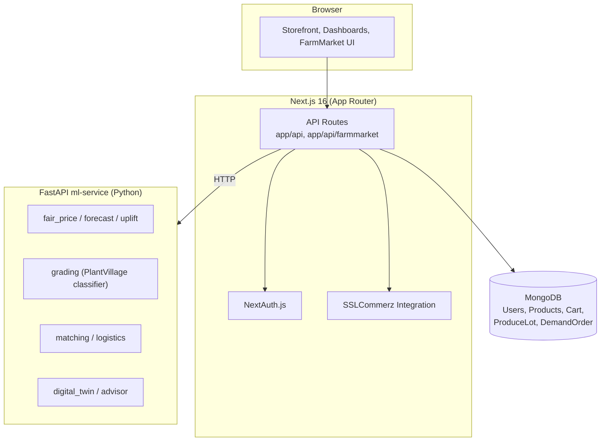

# KriShop

### Multi-Vendor E-Commerce Platform with FarmMarket: AI Price and Quality Advisor for Farmers


KriShop is a full-stack marketplace built with **Next.js 16** and **MongoDB**. It has two parts:

1. **KriShop Marketplace**: a multi-vendor e-commerce application with role-based dashboards for customers, vendors and administrators.
2. **FarmMarket**: an upgrade that helps smallholder farmers in Bangladesh decide *what price to ask* and *whether to sell today or wait*. A farmer uploads a produce photo and receives a quality grade, a fair-price recommendation, an honest uncertainty band, and one sentence of advice in Bangla. Buyer matching, dispatch and batch tracing are one click away.

All FarmMarket numbers come from the real datasets in `ml-service/data/`.

---

## Table of Contents

- [Quick Start](#quick-start)
- [FarmMarket Results at a Glance](#farmmarket-results-at-a-glance)
- [Theory of Change](#theory-of-change)
- [Marketplace Features](#marketplace-features)
- [System Architecture](#system-architecture)
- [Technology Stack](#technology-stack)
- [Project Structure](#project-structure)
- [Environment Configuration](#environment-configuration)
- [Available Scripts](#available-scripts)
- [FarmMarket Technical Notes](#farmmarket-technical-notes)
- [Field Photos](#field-photos)
- [Verification Status](#verification-status)
- [Security and Deployment Notes](#security-and-deployment-notes)
- [Roadmap](#roadmap)
- [Contributing](#contributing)
- [License](#license)

---

## Quick Start

### Option A: Docker (recommended)

The first build downloads images and packages, so allow several minutes.

```bash
docker compose up --build        # or: make demo
```

Open <http://localhost:3000/farmmarket>.

| Role | Email | Password |
|---|---|---|
| Farmer | `farmer@demo.test` | `demo1234` |
| Buyer | `buyer@demo.test` | `demo1234` |

This starts the Next.js app, the FastAPI ML service, and a MongoDB instance pre-loaded with 6 sample lots, 6 buy orders and 6 traceable batches (`B-0a1b2c01` to `B-0a1b2c06`). Batch `03` contains a deliberate cold-chain breach for demonstration.

### Option B: Local setup

**Prerequisites:** Node.js 18+ (check the Next.js 16 requirements for your installed version), Python 3, and a MongoDB instance (local or Atlas).

```bash
# 1. ML service
pip install -r requirements.txt
cd ml-service
python -m pytest tests                      # 15 tests
uvicorn farmmarket.api:app --port 8000

# 2. Web app (new terminal, repository root)
cp .env.example .env.local                  # then fill in the values
npm install
npm run dev                                 # http://localhost:3000/farmmarket
```

The price-only features (journey, market data, evidence) work without MongoDB. Lots, orders and matching require it.

> If you reuse a `node_modules` folder installed on another operating system, delete it and run `npm install` again. Tailwind ships platform-specific binaries. The distribution zip does not include `node_modules`.

---

## FarmMarket Results at a Glance

All results are measured on the real data. Full detail is in the app's Evidence tab and in `ml-service/models/*.json`.

| Component | Result |
|---|---|
| Photo classifier (38 PlantVillage classes) | **90.1%** held-out accuracy, macro-F1 0.90 (6,041 train / 1,511 test real images; random split of lab photos) |
| Price forecasts (10 series, 14-day error, rolling backtests) | Best model chosen per series. A plain "price stays put" baseline is hard to beat; Prophet lost on all series |
| Lagged weather features | Tested; helped on **1 of 10** series, so the app mostly does not use them |
| Timing rule, 2-year point-in-time replay | **+0.53%** average realised price across 5 crops (ungated). Garlic +0.83% (95% CI 0.06 to 1.73); cucumber -0.59% |
| Timing rule as shipped (wait advice only where the gain is reliable) | **+0.17%** average. Garlic only; every other crop is told to sell today |
| Field photos | None supplied yet. Accuracy on real field photos is **unmeasured** and expected to be well below 90.1% |

---

## Theory of Change

**Who:** a smallholder in Sylhet, Rajshahi or Chattogram who sells garlic, green chilli, chickpea, cucumber or sweet pumpkin to a local trader and has no view of national prices.

**Today:** the farmer accepts the trader's price on the day. In the data, wholesale prices swing 71% to 167% between the best and worst month (pumpkin 71%, garlic 74%, green chilli 167%), and wholesale is only 85-90% of the retail price.

**With FarmMarket:** the farmer sees
- the current national wholesale level,
- a price floor from the last year's prices (and their own cost, if entered),
- the best season to sell,
- a graded quality multiplier from a photo,
- freight to the buyer's hub, and
- a sell-today-or-wait decision whose uncertainty band comes from the model's measured past errors.

Farmers can also post lots to buyers and see recommended matches.

**Expected income difference (measured):** the timing rule alone is worth about **+0.83% on garlic** (95% CI 0.06 to 1.73), roughly ৳126 per 100 kg at the replay's average price of ৳171/kg (about ৳630 on a 500 kg lot). The gain comes from a few large wins: in the 15 of 103 weeks when the rule said wait, the median outcome was about zero, the worst 5% lost 5.8% and the best 5% gained 20.6%. The rule is not reliable on the other four crops, so they are told to sell today.

The larger, unmeasured lever is price transparency and grading at the point of negotiation. This dataset cannot quantify it because it has no grade, farm-gate or trader-offer data. Match results are recommendations, not settlement. Payment and escrow are not implemented.

---

## Marketplace Features

### Authentication and Access Control
- Registration and login with NextAuth.js.
- Role-based experiences for customers, vendors and administrators.

### Shopping Experience
- Browse, search and view product details.
- Real-time cart management (add and remove items).
- Order history.

### Vendor Management
- Create, update and delete vendor-owned products.
- Review own listings and sales from a dedicated dashboard.

### Administration
- Manage users, products and orders from a central dashboard.

### Checkout and Payment
- SSLCommerz checkout with payment success and failure handling.
- Credentials supplied through environment variables, never committed.

### User Interface
- Mobile-first, responsive layouts with Tailwind CSS.
- React Toastify and SweetAlert2 for notifications and confirmations.

### User Roles

| Role | Main capabilities |
|---|---|
| **Customer / User** | Browse and search products, manage cart, check out, view order history |
| **Vendor** | Manage own products and sales |
| **Administrator** | Manage users, products and orders across the platform |
| **Farmer / Buyer** (FarmMarket) | Farmers grade produce, get price advice and post lots. Buyers post orders and see recommended matches |

> **Access-control note:** enforce role and ownership checks in server-side API routes and actions. Hiding a button or link in the UI is not sufficient security.

---

## System Architecture



### FarmMarket ML service modules

```
ml-service/farmmarket/
├── data_sources.py   loads and cleans market_ml_dataset_final.csv
├── forecast.py       naive, seasonal-naive, ETS, Prophet, GBM (+/- lagged weather); rolling backtests
├── train.py          picks the best model per series -> models/metrics.json
├── uplift.py         2-year point-in-time replay of the timing rule -> models/uplift.json
├── analytics.py      seasonality, retail-vs-wholesale spread, volatility
├── fair_price.py     sell-now vs hold, ask price, quality + freight + spoilage, evidence-gated wait advice
├── grading.py        PlantVillage classifier (default) + out-of-distribution guard + HSV fallback
├── matching.py       Hungarian optimal lot-to-order assignment
├── logistics.py      multi-stop dispatch: time + CO2 + shelf-life deadlines
├── advisor.py        advice in bn/en/sw (Gemini if GEMINI_API_KEY is set, else templates)
└── digital_twin.py   hash-chained batch history + cold-chain breaches
```

---

## Technology Stack

| Layer | Technology | Purpose |
|---|---|---|
| Framework | Next.js 16 (App Router) | Web application |
| Language | JavaScript, Python | App logic, ML service |
| Database | MongoDB with Mongoose | Persistent data and models |
| Authentication | NextAuth.js | Login and sessions |
| Styling | Tailwind CSS | Responsive UI |
| Payment | SSLCommerz | Online checkout |
| Notifications | React Toastify, SweetAlert2 | Toasts and dialogs |
| ML service | FastAPI, scikit-learn, Prophet, statsmodels | Forecasting, grading, matching |
| Containers | Docker Compose | One-command demo (web, ML, MongoDB) |

---

## Project Structure

```text
krishop/
├── app/
│   ├── api/              # Backend API routes (incl. farmmarket)
│   ├── dashboard/        # Role-based dashboards
│   ├── farmmarket/       # FarmMarket UI
│   ├── login/            # Login pages
│   └── register/         # Registration pages
├── Components/           # Reusable UI components (Header, Cart, ProductCard, ...)
├── Model/                # Mongoose models (User, Product, CartModel, ProduceLot, DemandOrder)
├── utils/                # Database connection and helpers
├── ml-service/           # FastAPI service, datasets, trained models, tests, scripts
├── docker/               # Seed data (mongo-seed.js)
├── docs/                 # DEMO_SCRIPT.md (timed 95-second demo script)
├── docker-compose.yml
├── Makefile
├── requirements.txt
└── package.json
```

---

## Environment Configuration

Create `.env.local` in the project root (start from `.env.example`):

```env
MONGO_DB_URI=your_mongodb_connection_string
NEXTAUTH_SECRET=your_long_random_secret
NEXTAUTH_URL=http://localhost:3000

# SSLCommerz credentials (use sandbox credentials for testing)
STORE_ID=your_store_id
STORE_Pass=your_store_password

# Optional: enables Gemini-written advice in the FarmMarket advisor
GEMINI_API_KEY=your_gemini_api_key
```

Variable names are case-sensitive in many environments. Use the exact names defined in `.env.example` and the code. Never commit `.env.local` or any credentials.

---

## Available Scripts

| Command | Purpose |
|---|---|
| `npm run dev` | Start the development server (Turbopack) |
| `npm run build` | Build for production |
| `npm start` | Start the production server |
| `npm run lint` | Run ESLint |
| `make demo` | Build and start everything with Docker |
| `make test` | Run the ML service tests |
| `make train` | Retrain forecast models (about 4 min) |
| `make uplift` | Re-run the timing-rule replay (about 3 min; run after `train`) |
| `make vision` | Retrain the photo classifier (about 6 min) |

---

## FarmMarket Technical Notes

### What the data supports (and what it does not)

**`market_ml_dataset_final.csv`** (AgriPriceBD): 17,752 rows of daily BDT/kg retail and wholesale prices for 5 crops (chickpea, cucumber, local garlic, green chilli, sweet pumpkin), from 2020-07-22 to 2025-06-04.

- **Cleaning** (see `data_sources.quality_report()`): 2 non-kg rows dropped, 4 zero prices treated as missing, gaps of up to 7 days forward-filled.
- **Prices are national.** The file has no market location. Hubs are used only for freight distance, so the app does not claim city-to-city arbitrage.
- **The data ends on 2025-06-04.** The UI shows a staleness banner. To go live, append new rows in the same format, call `POST /data/reload`, then run `make train && make uplift`.
- **Wholesale price is a proxy for the farm-gate price.** Enter your own cost per kg for a cost-based floor.
- **Forecast inputs are limited to what is known at the forecast date.** The weather columns are same-day observations, so only *lagged* weather is tested. Real weather forecasts have no history in this data.

### Forecasting result

Prices move slowly, so a plain "tomorrow = today" baseline is hard to beat. Backtests chose:

- naive on 5 of 10 series,
- gradient boosting without weather on 3,
- seasonal-naive on garlic wholesale (1), and
- lagged-weather boosting on pumpkin retail (1).

Prophet was worse than naive on all ten (for example 21.7% vs 4.6% error on garlic wholesale). Cucumber and green chilli are genuinely volatile (14-day error roughly 13-37%), so treat their forecasts as wide.

### Timing-rule replay (`uplift.py`)

Every 7 days over the last two years, using only data available on that date, the rule's decision is compared with selling immediately, on realised prices net of spoilage. Waiting is advised only where the 95% interval of the gain excludes zero (garlic only). The gate was chosen on the same replay it is reported on, so the +0.83% figure is somewhat optimistic. Grade effects cannot be measured because there is no grade data.

### Photo classifier

**`plantvillage_image_labels.csv`** contains 54,303 label rows (38 classes) and no images. It supplies the class catalog (`data/disease_catalog.json`).

- The classifier was trained on **7,552 real PlantVillage images** (200 per class, fetched by `scripts/fetch_plantvillage.py` from the public GitHub mirror) using hand-crafted colour and texture features with gradient boosting (`scripts/train_vision_lite.py`).
- It is **not** a MobileNet or EfficientNet, because ImageNet weights and a deep-learning framework were unavailable in the build environment. `train_vision.py` (MobileNetV3) is included for GPU users but is untested and not used by the API.
- The 90.1% accuracy is on a random split of lab photos with uniform backgrounds. PlantVillage has several photos per leaf, so this overstates field accuracy.
- An out-of-distribution guard (distance to training images) routes non-leaf images to a transparent HSV colour baseline, and the response states which backend was used.
- PlantVillage has no cucumber, garlic or chickpea classes, so for those crops the grade is a general quality signal. The A/B/C severity tiers are an assumption, not part of the dataset.

### Other notes

- The digital twin is a single-writer hash chain (tamper-evident), not a distributed blockchain.
- Match results are recommendations. Deal confirmation and payment escrow are not automated.
- Shelf-life, freight and storage-temperature figures in `config.py` and `digital_twin.py` are assumptions.

---

## Field Photos

`ml-service/data/field_photos/README.md` explains the folder layout.

1. **Measure honestly:** put photos the model has never seen in `data/field_photos_test/` and run:
   ```bash
   python scripts/eval_field_photos.py --dir data/field_photos_test
   ```
   This reports field accuracy and how many photos the out-of-distribution guard sent to the colour fallback.
2. **Improve the model:** add different photos under `data/field_photos/<PlantVillage class name>/` and run:
   ```bash
   python scripts/train_vision_lite.py --data /tmp/pvdata --extra data/field_photos
   ```
3. **Re-evaluate** on the untouched test photos. Quote the field number, not the 90.1%.

---

## Verification Status

**Verified in the build environment** (no Docker daemon was available there, so `docker compose up --build` itself has not been run):

- **Web image steps:** clean `npm ci` and production `npm run build` in a fresh copy of the repository, with no network font fetch (system font stack); then `next start`, and `/farmmarket` loaded (HTTP 200, no console errors) in headless Chromium.
- **ML image steps:** fresh virtualenv installed from `requirements.txt`; 15 tests passed; `scripts/seed_twin.py` ran; `uvicorn` served `/health`, `/fair-price`, `/grade` (a real PlantVillage image classified) and `/twin/B-0a1b2c03` (chain valid, 1 breach).
- **Seed data:** `docker/mongo-seed.js` ran against a stub of the mongo shell (2 users, 6 lots, 6 orders into database `krishop`); `docker-compose.yml` parses with the expected 3 services.
- **Browser journey (headless Chromium, real services):** photo upload, grade, ask price, sell/wait decision, band chart, what-if slider, trader-price calculator, replay story, three-sentence Bangla advice, and the Evidence and Market tabs.
- Two real bugs were found and fixed by these checks: a mongo-shell variable clash in the seed script, and `scikit-learn`/`joblib` missing from `requirements.txt`.

**Not verified:** the Docker build and run itself, a real MongoDB (lots, orders, matching, login), and the dispatch tab (requires login). Please run `docker compose up --build` once and report anything that fails.

No demo video is included. `docs/DEMO_SCRIPT.md` is a timed 95-second script using the real numbers.

---

## Security and Deployment Notes

Before deploying for real users, review the following:

- **Authorization:** verify roles and resource ownership in server-side routes and actions.
- **Passwords and sessions:** hash credentials securely and configure session settings appropriately.
- **Payment verification:** verify gateway responses server-side and make order updates idempotent. A browser redirect alone is not proof of payment.
- **Input validation:** validate and sanitize user-controlled input on the server.
- **Secrets:** store production secrets in the deployment platform's environment configuration.
- **Database access:** use least-privilege credentials and restrict network access.
- **Error handling:** do not expose stack traces, secrets or customer data in responses and logs.
- **Demo accounts:** remove the seeded `demo1234` users before any public deployment.
- **Testing:** cover registration, role permissions, product ownership, cart totals, checkout failures, payment verification and order-status transitions.

These are recommended checks, not a statement that the application has passed a security audit.

---

## Roadmap

- [ ] Measure classifier accuracy on real field photos and retrain with them
- [ ] Refresh market data beyond 2025-06-04 and automate retraining
- [ ] Farm-gate and trader-offer data to quantify the price-transparency effect
- [ ] Deal confirmation and payment escrow for FarmMarket matches
- [ ] Product filtering, sorting and richer search
- [ ] Vendor analytics, reviews and ratings
- [ ] Inventory tracking and order-status notifications
- [ ] Delivery tracking and additional payment methods
- [ ] Automated tests for checkout, authorization and order management
- [ ] Production monitoring, backups and a security review

---

## Contributing

1. Fork the repository.
2. Create a feature branch.
3. Make and test your changes.
4. Commit with a clear message.
5. Open a pull request describing the change.

For substantial changes, please discuss the approach with the maintainers first.

---

## License

Add the project's chosen license and include the corresponding `LICENSE` file before distributing the application. No license information has been provided yet.

---

**KriShop: connecting customers, empowering vendors, and giving farmers honest price intelligence.**
