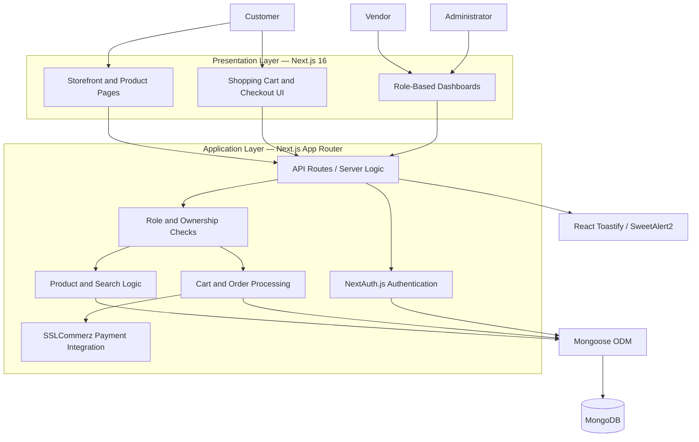
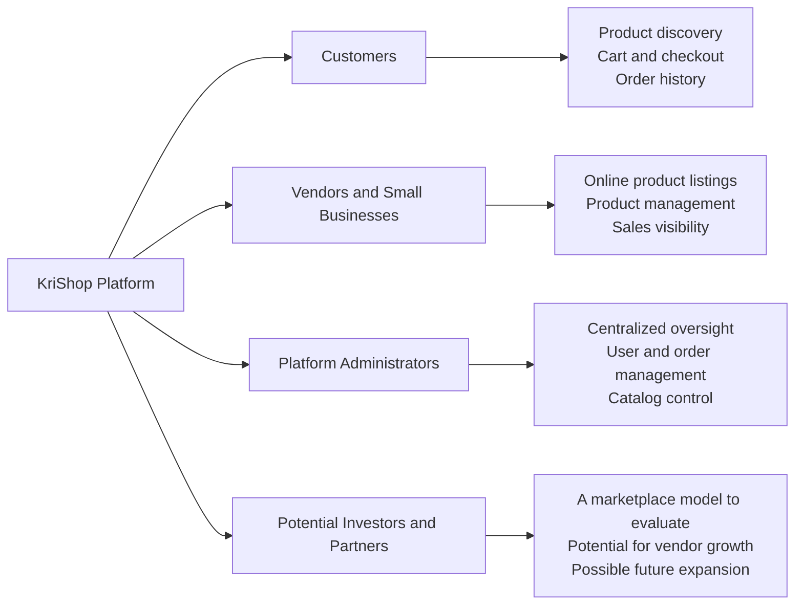

# KriShop FarmMarket: reproduce in minutes

**What it is:** a farmer uploads a produce photo, gets a grade and a fair-price recommendation, and sees whether to sell today or wait,
with an honest uncertainty band and one sentence of advice in Bangla. Buyers, matching, dispatch and batch tracing are one click away.
All numbers come from your real datasets in `ml-service/data/`.

**Option A: Docker (the first build downloads images and packages, so allow several minutes)**
```bash
docker compose up --build        # or: make demo
# open http://localhost:3000/farmmarket
# logins: farmer@demo.test (farmer), buyer@demo.test (buyer), password demo1234
```
Starts the Next.js app, the FastAPI ML service and a MongoDB pre-loaded with 6 sample lots, 6 buy orders, and 6 traceable batches
(`B-0a1b2c01`..`06`; `03` has a deliberate cold-chain breach).

**Option B: local**
```bash
pip install -r requirements.txt
cd ml-service && python -m pytest tests && uvicorn farmmarket.api:app --port 8000     # 15 tests
# new terminal, repo root: cp .env.example .env.local (fill in MONGO_URI etc.)
npm install && npm run dev                                                           # http://localhost:3000/farmmarket
```
The price-only features (journey, market data, evidence) work without MongoDB; lots, orders and matching need it.

## Results at a glance (all measured on the real data; full detail in the Evidence tab and `ml-service/models/*.json`)
| Component | Result |
|---|---|
| Photo classifier (38 PlantVillage classes) | **90.1%** held-out accuracy, macro-F1 0.90 (6,041 train / 1,511 test real images; random split, lab photos) |
| Price forecasts (10 series, 14-day error, rolling backtests) | best model per series; **plain "price stays put" is hard to beat**; Prophet lost on all series |
| Known-at-forecast-time weather | lagged weather features tested; helped on **1 of 10** series, so the app mostly does not use them |
| Timing rule, 2-year point-in-time replay | **+0.53%** average realised price across 5 crops (ungated); garlic +0.83% (95% CI 0.06 to 1.73), cucumber -0.59% |
| As shipped (wait advice only where the gain is reliable) | **+0.17%** average; garlic only; every other crop is told to sell today |
| Field photos | none supplied yet; the classifier's accuracy on real field photos is **unmeasured** (expected to be well below 90.1%) |

## Theory of change
**Who:** a smallholder in Sylhet, Rajshahi or Chattogram who sells garlic, green chilli, chickpea, cucumber or sweet pumpkin to a local trader and has
no view of national prices. **Today** they accept the trader's price on the day, without knowing that wholesale prices in the data swing 71% to 167% between
the best and worst month (pumpkin 71%, garlic 74%, green chilli 167%) or that wholesale is only 85-90% of the retail price. **With FarmMarket** they see the
current national wholesale level, a floor from the last year's prices (and their own cost if entered), the best season to sell, a graded quality multiplier from a photo,
freight to the buyer's hub, and a sell-today-or-wait decision whose uncertainty band comes from the model's measured past errors. They can also post lots to
buyers and see recommended matches. **Expected income difference, measured:** the timing rule alone is worth about +0.83% on garlic
(95% CI 0.06 to 1.73), or about ৳126 per 100 kg at the replay's average price of ৳171/kg (≈৳630 on a 500 kg lot), and it comes from a few large wins: when the
rule said wait (15 of 103 weeks), the median outcome was about zero, the worst 5% lost 5.8% and the best 5% gained 20.6%. It is nothing reliable on the other four crops (they are told to sell today); the larger, unmeasured lever is price transparency and grading at
the point of negotiation, which this dataset cannot quantify (it has no grade, farm-gate or trader-offer data). Match results are
recommendations, not settlement; payment and escrow are not implemented.

## Verification status
Verified in the build environment (no Docker daemon was available there, so `docker compose up --build` itself has not been run):
* **Web image steps:** clean `npm ci` and a production `npm run build` in a fresh copy of the repo, with no network font fetch (system font stack); then `next start`, and the `/farmmarket` page loaded (HTTP 200, no console errors) in headless Chromium.
* **ML image steps:** a fresh virtualenv installed from `requirements.txt`, 15 tests passed, `scripts/seed_twin.py` ran, `uvicorn` started and served `/health`, `/fair-price`, `/grade` (real PlantVillage image classified) and `/twin/B-0a1b2c03` (chain valid, 1 breach).
* **Seed data:** `docker/mongo-seed.js` executed against a stub of the mongo shell: 2 users, 6 lots, 6 orders into database `krishop`; `docker-compose.yml` parses with the expected 3 services.
* **Browser journey (headless Chromium, against the real services):** photo upload, grade, ask price, sell/wait decision, band chart, what-if slider, trader-price calculator, replay story, three-sentence Bangla advice, and the Evidence and Market tabs rendered.
* Two real bugs were found and fixed by these checks (a mongo-shell variable clash in the seed script, and `scikit-learn`/`joblib` missing from `requirements.txt`).

Not verified: the Docker build/run itself, a real MongoDB (lots, orders, matching, login), and the dispatch tab (requires login). Run `docker compose up --build` once and report anything that fails.
If you reuse an old `node_modules` folder installed on another operating system, delete it and run `npm install` (Tailwind ships platform-specific binaries); the zip does not include `node_modules`.
No demo video is included (it cannot be recorded here). `docs/DEMO_SCRIPT.md` is a timed 95-second script using the real numbers.
No field photos were available when this was built; see "Field photos" below.

---

# KriShop

KriShop is a modern e-commerce application built with Next.js 16 and MongoDB. It features a comprehensive shopping experience with role-based dashboards for users, vendors, and admins.

## Features

-   **Authentication**: Secure login and registration using NextAuth.js.
-   **Role-Based Access**: Specialized dashboards for different user roles:
    -   **User**: Browse products, manage cart, view order history.
    -   **Vendor**: Manage own products and sales.
    -   **Admin**: Full system oversight, manage users, products, and orders.
-   **Product Management**: Browse, search, and view product details. Admins and Vendors can create, update, and delete products.
-   **Shopping Cart**: Real-time cart management with add/remove functionality.
-   **Checkout & Payment**: Integrated checkout flow (SSLCommerz) with payment success/failure handling.
-   **Responsive Design**: Built with Tailwind CSS for a mobile-first, responsive interface.

## Tech Stack

-   **Framework**: [Next.js 16](https://nextjs.org/) (App Router)
-   **Language**: JavaScript
-   **Database**: [MongoDB](https://www.mongodb.com/) (with Mongoose ODM)
-   **Authentication**: [NextAuth.js](https://next-auth.js.org/)
-   **Styling**: [Tailwind CSS](https://tailwindcss.com/)
-   **Notifications**: React Toastify & SweetAlert2

## Getting Started

Follow these steps to set up the project locally.

### Prerequisites

-   Node.js (v18 or later recommended)
-   MongoDB Database (local or Atlas)

### Installation

1.  **Clone the repository:**

    ```bash
    git clone https://github.com/yourusername/krishop.git
    cd krishop
    ```

2.  **Install dependencies:**

    ```bash
    npm install
    ```

3.  **Environment Setup:**

    Create a `.env.local` file in the root directory and add the following variables:

    ```env
    MONGO_DB_URI=your_mongodb_connection_string
    NEXTAUTH_SECRET=your_nextauth_secret_key
    NEXTAUTH_URL=http://localhost:3000

    # Store ID and Password for Payment Gateway (if applicable)
    STORE_ID=your_store_id
    STORE_Pass=your_store_password
    ```

4.  **Run the development server:**

    ```bash
    npm run dev
    ```

    Open [http://localhost:3000](http://localhost:3000) with your browser to see the result.

## Project Structure

-   `app/`: Main application code (App Router).
    -   `api/`: Backend API routes.
    -   `dashboard/`: Role-based dashboard pages.
    -   `login/` & `register/`: Authentication pages.
-   `Components/`: Reusable UI components (Header, Cart, ProductCard, etc.).
-   `Model/`: Mongoose data models (User, Product, CartModel).
-   `utils/`: Utility functions (Database connection, helper scripts).

## Scripts

-   `npm run dev`: Runs the development server with Turbopack.
-   `npm run build`: Builds the application for production.
-   `npm start`: Starts the production server.
-   `npm run lint`: Runs ESLint for code quality.

---

# FarmMarket upgrade: technical notes

```
Next.js (app/farmmarket, app/api/farmmarket) --HTTP--> FastAPI ml-service (Python)
        |                                                  |- data_sources.py  loads + cleans market_ml_dataset_final.csv
   MongoDB: ProduceLot, DemandOrder                        |- forecast.py      naive, seasonal-naive, ETS, Prophet, GBM (+/- lagged weather); rolling backtests
                                                           |- train.py         picks best model per series -> models/metrics.json
                                                           |- uplift.py        2-year point-in-time replay of the timing rule -> models/uplift.json
                                                           |- analytics.py     seasonality, retail-vs-wholesale spread, volatility
                                                           |- fair_price.py    sell-now vs hold, ask price, quality + freight + spoilage, evidence-gated wait advice
                                                           |- grading.py       PlantVillage classifier (default) + out-of-distribution guard + HSV fallback
                                                           |- matching.py      Hungarian optimal lot<->order assignment
                                                           |- logistics.py     multi-stop dispatch: time + CO2 + shelf-life deadlines
                                                           |- advisor.py       advice in bn/en/sw (Gemini if GEMINI_API_KEY, else templates)
                                                           '- digital_twin.py  hash-chained batch history + cold-chain breaches
```
Useful commands: `make test`, `make train` (~4 min), `make uplift` (~3 min, run after train), `make vision` (~6 min).

## What the data supports (and what it does not)
**`market_ml_dataset_final.csv`** (AgriPriceBD): 17,752 rows, daily BDT/kg, retail + wholesale, 5 crops
(chickpea, cucumber, local garlic, green chilli, sweet pumpkin), 2020-07-22 to 2025-06-04.
* Cleaning (see `data_sources.quality_report()`): 2 non-kg rows dropped, 4 zero prices treated as missing, gaps of up to 7 days forward-filled.
* **Prices are national: the file has no market location.** Hubs are used only for freight distance, so the app does not claim city-to-city arbitrage.
* **The data ends 2025-06-04.** The UI shows a staleness banner. To go live, append new rows in the same format, call `POST /data/reload`, then `make train && make uplift`.
* Wholesale price is a proxy for the farm-gate price. Enter your own cost per kg for a cost-based floor.
* **Forecast inputs are limited to what is known at the forecast date.** The dataset's weather columns are same-day observations, so only *lagged* weather (rain and temperature up to the forecast date) is tested; real weather *forecasts* have no history in this data. Result: lagged weather helped on 1 of 10 series.

**Forecasting result (honest):** prices move slowly, so a plain "tomorrow = today" baseline is hard to beat. Backtests chose naive on 5 of 10 series,
gradient boosting without weather on 3, seasonal-naive on garlic wholesale (1) and lagged-weather boosting on pumpkin retail (1). Prophet was worse than naive on all ten
(e.g. 21.7% vs 4.6% error on garlic wholesale). Cucumber and green chilli are genuinely volatile (14-day error roughly 13-37%); treat their forecasts as wide.

**Timing-rule replay (`uplift.py`)**: every 7 days over the last two years, using only data available on that date, the rule's decision is compared with
selling immediately, on realised prices net of spoilage. Waiting is only advised where the 95% interval of the gain excludes zero (garlic only). The gate was chosen
on the same replay it is reported on, so the +0.83% is somewhat optimistic. Grade effects cannot be measured (no grade data).

**`plantvillage_image_labels.csv`**: 54,303 rows of labels only (38 classes); no images. It supplies the class catalog (`data/disease_catalog.json`).
* The classifier was trained on **7,552 real PlantVillage images** (200 per class, fetched by `scripts/fetch_plantvillage.py` from the public GitHub mirror), using hand-crafted colour/texture features and gradient boosting (`scripts/train_vision_lite.py`). It is **not** a MobileNet/EfficientNet: ImageNet weights and a deep-learning framework were not available in the build environment. `train_vision.py` (MobileNetV3, untested, not used by the API) is there if you have a GPU.
* 90.1% accuracy is on a random split of lab photos with uniform backgrounds; PlantVillage has several photos per leaf, so this overstates accuracy on field photos. To add your own field photos, put them in `ml-service/data/field_photos/<PlantVillage class name>/` and run `python scripts/train_vision_lite.py --data /tmp/pvdata --extra data/field_photos`.
* An out-of-distribution guard (distance to training images) sends non-leaf images to the transparent HSV colour baseline, and the response says which backend was used. PlantVillage has no cucumber, garlic or chickpea classes; for your crops the grade is a general quality signal. The A/B/C severity tiers are an assumption, not part of the dataset.

## Field photos
`ml-service/data/field_photos/README.md` explains the folder layout. Put photos the model has never seen in `data/field_photos_test/` and run
`python scripts/eval_field_photos.py --dir data/field_photos_test` to get an honest field accuracy (it also reports how many photos the out-of-distribution
guard sent to the colour fallback). To improve the model, add different photos under `data/field_photos/` and run
`python scripts/train_vision_lite.py --data /tmp/pvdata --extra data/field_photos`, then re-evaluate on the untouched test photos. Quote the field number, not the 90.1%.

Other notes: the digital twin is a single-writer hash chain (tamper-evident), not a distributed blockchain. Match results are recommendations; confirming deals and
payment escrow are not automated. Shelf-life, freight and storage-temperature figures in `config.py` / `digital_twin.py` are assumptions.
=======
# 🛍️ KriShop

### A Modern Multi-Vendor E-Commerce Platform

> **Discover products. Empower vendors. Simplify online shopping.**

KriShop is a modern e-commerce application built with **Next.js 16** and **MongoDB**. It provides a shopping experience with role-based dashboards for customers, vendors, and administrators. The platform brings product discovery, cart management, order tracking, and online checkout into one responsive application.


---

## 📌 Table of Contents

- [Overview](#-overview)
- [Key Features](#-key-features)
- [User Roles](#-user-roles)
- [System Architecture](#-system-architecture)
- [System Workflow](#-system-workflow)
- [Who Benefits from KriShop?](#-who-benefits-from-krishop)
- [Technology Stack](#-technology-stack)
- [Project Structure](#-project-structure)
- [Getting Started](#-getting-started)
- [Environment Configuration](#-environment-configuration)
- [Available Scripts](#-available-scripts)
- [Security and Deployment Notes](#-security-and-deployment-notes)
- [Roadmap](#-roadmap)
- [Contributing](#-contributing)
- [License](#-license)

---

## 🌟 Overview

KriShop is designed to support a convenient online marketplace where customers can explore products, vendors can manage their own listings and sales, and administrators can oversee platform activity.

The application uses the **Next.js App Router** for the web experience, **MongoDB** for data storage, and **Mongoose** for database modeling. Authentication is handled with **NextAuth.js**, while the checkout flow integrates **SSLCommerz** for payment processing.

### Project Goals

- Make product discovery and purchasing accessible through a responsive interface.
- Give vendors tools to manage products and sales.
- Provide administrators with centralized platform-management capabilities.
- Support a clear checkout and payment-result flow.
- Establish a foundation that can be extended as marketplace needs evolve.

---

## ✨ Key Features

### 🔐 Authentication and Access Control
- User registration and login with NextAuth.js.
- Role-based experiences for customers, vendors, and administrators.
- Protected dashboard areas should be configured to enforce permissions on the server as well as in the UI.

### 🛒 Shopping Experience
- Browse and search products.
- View individual product details.
- Add items to and remove items from the shopping cart.
- Review order history.

### 🏪 Vendor Management
- Create, update, and delete vendor-owned products.
- Manage product listings and review sales information.
- Keep vendor operations organized through a dedicated dashboard.

### 🧭 Administration
- Manage users, products, and orders.
- Monitor key platform activity from an administrative dashboard.

### 💳 Checkout and Payment
- Checkout flow integrated with SSLCommerz.
- Payment success and failure handling.
- Payment credentials are configured through environment variables rather than committed to source control.

### 📱 Responsive Interface
- Mobile-first layouts using Tailwind CSS.
- Reusable UI components for a consistent shopping experience.

### 🔔 User Feedback
- React Toastify and SweetAlert2 for notifications and confirmation dialogs.

---

## 👥 User Roles

| Role | Main capabilities | Value |
|---|---|---|
| **Customer** | Browse and search products, manage cart, complete checkout, view order history | A convenient, centralized shopping experience |
| **Vendor** | Manage own products and sales through a dedicated dashboard | A digital channel to present products and manage sales |
| **Administrator** | Manage users, products, and orders | Centralized oversight and platform administration |

> **Access-control note:** Enforce role and ownership checks in server-side API routes/actions. Hiding a button or dashboard link in the frontend alone is not sufficient security.

---

## 🏗️ System Architecture

The following diagram shows the intended high-level architecture based on the technologies and features described for KriShop.



### Architecture Overview

1. **Presentation layer:** Responsive storefront, product pages, cart, checkout, and role-based dashboards.
2. **Application layer:** Next.js server-side logic and API routes handle application operations.
3. **Authentication and authorization:** NextAuth.js supports authentication; application logic must enforce each role's permissions.
4. **Data layer:** Mongoose provides structured interaction with MongoDB.
5. **Payment integration:** SSLCommerz supports the checkout payment flow and payment-result handling.
6. **Feedback layer:** Toast notifications and confirmation dialogs communicate actions and errors to users.

*This is a conceptual architecture diagram, not a claim that every component has been independently audited or that all integrations are production-hardened.*

---

## 🔄 System Workflow

This workflow illustrates a typical customer purchase alongside the role-based management flow.


### Typical Customer Journey

1. The customer visits KriShop and browses the product catalog.
2. They inspect product details and add items to the cart.
3. They review the cart and continue to checkout.
4. The payment flow redirects or connects to SSLCommerz as configured.
5. The application handles the payment result and presents the appropriate status.
6. The customer can review order history.

**Implementation consideration:** Order creation, payment verification, and order-status updates should be handled securely on the server. A browser redirect alone should not be treated as proof of payment; verify payment using the gateway's supported validation mechanism.

---

## 💼 Who Benefits from KriShop?

KriShop is intended to create value for several groups.



### 🛍️ For Customers
- Browse and search products from a digital storefront.
- Manage a shopping cart and access the checkout flow.
- Review order history in one place.
- Use a responsive interface across supported screen sizes.

### 🏪 For Vendors and Small Businesses
- Create and maintain their own product listings.
- Update product information as their catalog changes.
- Access a dedicated area for managing products and sales.
- Potentially reach customers through a shared marketplace, subject to the platform's actual launch and marketing strategy.

### 🧑‍💼 For Administrators
- Manage users, products, and orders from a centralized dashboard.
- Maintain oversight of platform operations.
- Support more consistent marketplace administration.

### 📈 For Investors and Strategic Partners
KriShop may offer a foundation for a multi-vendor commerce business. Potential areas of value to assess include:

- **Marketplace growth:** Whether customer demand and vendor participation can grow together.
- **Revenue opportunities:** Possible future commission, vendor subscription, featured listing, or service-fee models, if introduced and validated.
- **Operational scalability:** Opportunities to improve catalog management, order processing, vendor onboarding, and customer support as activity increases.
- **Expansion potential:** Possibilities for new product categories, delivery partnerships, analytics, and additional payment options.
- **Measurable traction:** Future assessment through active customers, active vendors, conversion rate, repeat purchase rate, order volume, average order value, and contribution margin.

> **Investor transparency:** These are potential benefits and business opportunities, not guaranteed outcomes. No revenue, user growth, profitability, funding, or market traction figures have been provided. Investors should evaluate the business model, operating costs, market demand, security, and actual performance data before making investment decisions.

---

## 🧰 Technology Stack

| Layer | Technology | Purpose |
|---|---|---|
| Framework | Next.js 16 | Web application and App Router |
| Language | JavaScript | Application logic |
| Database | MongoDB | Persistent application data |
| ODM | Mongoose | MongoDB models and data access |
| Authentication | NextAuth.js | Login and session management |
| Styling | Tailwind CSS | Responsive interface |
| Payment | SSLCommerz | Online checkout integration |
| Notifications | React Toastify | Toast notifications |
| Dialogs | SweetAlert2 | Alerts and confirmation dialogs |
| Package manager | npm | Dependency management |

---

## 📁 Project Structure

The following is the project structure described in the supplied project notes. Actual filenames may differ in the repository.

```text
krishop/
├── app/
│   ├── api/              # Backend API routes
│   ├── dashboard/        # Role-based dashboards
│   ├── login/            # Login pages
│   ├── register/         # Registration pages
│   └── ...               # Storefront and other App Router pages
├── Components/           # Reusable UI components
│   ├── Header
│   ├── Cart
│   └── ProductCard
├── Model/                # Mongoose models
│   ├── User
│   ├── Product
│   └── CartModel
├── utils/                # Database connection and helpers
├── public/               # Static assets, if present
├── .env.local            # Local environment variables (do not commit)
├── package.json
└── README.md
```

---

## 🚀 Getting Started

### Prerequisites

- **Node.js:** Version 18 or later is recommended by the supplied project notes. Check the requirements of the installed Next.js 16 release and use a compatible Node.js version.
- **npm:** Included with Node.js.
- **MongoDB:** A local instance or MongoDB Atlas database.
- **SSLCommerz credentials:** Required to test the payment integration.

### 1. Clone the Repository

Replace the placeholder URL with the actual repository URL.

```bash
git clone https://github.com/yourusername/krishop.git
cd krishop
```

### 2. Install Dependencies

```bash
npm install
```

### 3. Configure Environment Variables

Create a `.env.local` file in the project root:

```env
MONGO_DB_URI=your_mongodb_connection_string
NEXTAUTH_SECRET=your_long_random_secret
NEXTAUTH_URL=http://localhost:3000

# SSLCommerz credentials — use sandbox credentials for testing
STORE_ID=your_store_id
STORE_Pass=your_store_password
```

Use the exact variable names expected by the project's implementation. Environment-variable names are case-sensitive in many deployment environments; confirm whether the payment integration expects `STORE_Pass` or a different spelling.

**Important:** Never commit `.env.local`, database credentials, authentication secrets, or payment-gateway credentials to a public repository.

### 4. Start the Development Server

```bash
npm run dev
```

Open [http://localhost:3000](http://localhost:3000) in your browser.

### 5. Create a Production Build

```bash
npm run build
npm start
```

---

## 📜 Available Scripts

| Command | Purpose |
|---|---|
| `npm run dev` | Start the development server with the configured Next.js tooling |
| `npm run build` | Build the application for production |
| `npm start` | Start the production server |
| `npm run lint` | Run the configured linting script |

Run scripts from the project root. The available commands depend on the scripts defined in `package.json`.

---

## 🔐 Security and Deployment Notes

Before deploying KriShop for real customers, review the following:

- **Authorization:** Verify roles and resource ownership in server-side routes and actions.
- **Passwords and sessions:** Use secure password hashing where credentials are stored and configure authentication/session settings appropriately.
- **Payment verification:** Verify gateway responses server-side and make order updates idempotent to reduce duplicate-processing risks.
- **Input validation:** Validate and sanitize user-controlled input on the server.
- **Secrets:** Store production secrets in the deployment platform's environment configuration.
- **Database access:** Use least-privilege database credentials and appropriate network access restrictions.
- **Error handling:** Avoid exposing stack traces, secrets, or sensitive customer information in responses and logs.
- **Privacy:** Collect only necessary customer data and document its handling.
- **Testing:** Test registration, role permissions, product ownership, cart calculations, checkout failures, payment verification, and order status transitions.

These are recommended checks, not a statement that the current application has already passed a security audit.

---

## 🗺️ Roadmap

Possible future enhancements, subject to project priorities:

- [ ] Product filtering, sorting, and richer search.
- [ ] Vendor analytics and sales reports.
- [ ] Customer reviews and ratings.
- [ ] Inventory tracking and low-stock alerts.
- [ ] Order-status notifications.
- [ ] Delivery and shipment tracking.
- [ ] Additional payment methods.
- [ ] Marketplace performance dashboards.
- [ ] Automated tests for checkout, authorization, and order management.
- [ ] Production monitoring, backups, and security review.

---

## 🤝 Contributing

Contributions, bug reports, and feature suggestions are welcome.

1. Fork the repository.
2. Create a feature branch.
3. Make your changes and test them.
4. Commit with a clear message.
5. Open a pull request describing the change.

For substantial changes, discuss the proposed approach with the project maintainers first.

---

## 📄 License

Add the project's chosen license and include the corresponding `LICENSE` file before distributing the application. No license information was provided in the supplied project description.

---

## 🌟 Final Note

**KriShop** brings together product discovery, vendor product management, customer checkout, and administrative oversight in one modern e-commerce application.

Its long-term opportunity depends on delivering a secure and reliable shopping experience, building trust with vendors and customers, and validating a sustainable marketplace business model.

> **KriShop — Connecting Customers, Empowering Vendors, Enabling Digital Commerce.**

